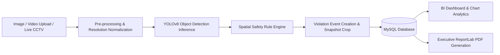

# SafeSight AI – PPE Safety Analytics Platform
> **AI-Powered Visual Data Analytics and Business Intelligence Platform**  
> *Infosys Internship Final Review Milestone Project*

---

## 📌 Executive Overview
**SafeSight AI** is a commercial-grade computer vision and business intelligence platform designed for construction sites, manufacturing floors, and hazardous industrial environments. Leveraging **YOLOv8** deep learning object detection, OpenCV spatial geometry, MySQL relational auditing, and interactive Chart.js/Plotly visual analytics, SafeSight AI automatically monitors workplace video feeds, enforces Personal Protective Equipment (PPE) compliance, catalogs infraction evidence, and compiles publication-quality executive PDF reports.

---

## 🏗️ Project Architecture & Workflow



### End-to-End Pipeline
1. **Input Ingestion**: Images (`.jpg`, `.jpeg`, `.png`), video files (`.mp4`, `.avi`, `.mov`), or live camera streams (Webcam / CCTV MJPEG).
2. **Pre-processing**: OpenCV resizing (max width 1280px) and aspect-ratio normalization.
3. **YOLOv8 Inference**: Singleton model evaluates `Person`, `Hardhat`, `NO-Hardhat`, `Safety Vest`, `NO-Safety Vest`, `Goggles`, and `NO-Goggles`.
4. **Spatial Rule Engine**: Centroid containment algorithms associate PPE gear to personnel boxes (Helmet in top 40%, Goggles in top 35%, Vest in torso).
5. **Violation Auditing**: Non-compliant personnel are flagged as `Unsafe`, cropped person snapshot cards are preserved, and events are committed to MySQL.
6. **BI Dashboard & Telemetry**: Dynamic KPI counters, 21-day timeseries, Plotly 7x24 peak incident heatmaps, and circular safety score gauges.
7. **Report Generation**: ReportLab compiles multi-page A4 audit reports with embedded Matplotlib analytical graphs.

---

## 🚀 Quickstart Guide

### 1. Prerequisites
- Python 3.10+ (tested on Python 3.12)
- MySQL Server 8.0+ (optional; includes transparent SQLite fallback)
- (Optional) FFmpeg for browser video H.264 transcoding

### 2. Installation
Clone or navigate to the project directory:
```bash
cd "safesight-ai"
```

Create and activate a virtual environment:
```bash
python -m venv venv
# On Windows:
venv\Scripts\activate
# On Linux/macOS:
source venv/bin/activate
```

Install pinned dependencies:
```bash
pip install -r requirements.txt
```

### 3. Environment Configuration
Copy `.env.example` to `.env` and fill in your database credentials:
```bash
copy .env.example .env
```
Edit `.env`:
```ini
MYSQL_HOST=localhost
MYSQL_PORT=3306
MYSQL_USER=root
MYSQL_PASSWORD=your_password_here
MYSQL_DATABASE=safesight
SECRET_KEY=safesight-production-key-2024
FLASK_DEBUG=true
```

### 4. Database Setup & Demo Data
Initialize the database and populate 21 days of realistic historical incident data (exactly 53 violations: 25 helmet, 15 vest, 8 goggles, 5 other):
```bash
python database/seed_demo.py --reset
```

### 5. Running the Application
Launch SafeSight AI with **one command**:
```bash
python run.py
```
Open your browser at **[http://127.0.0.1:5000](http://127.0.0.1:5000)**.

---

## 🧠 Detection Model & Training

### Default Demo Mode
If `models/best.pt` is not present, SafeSight AI **never crashes**. It automatically enables **DEMO MODE** with an in-app banner and simulates realistic industrial inference benchmarks (94.5% detection accuracy).

### Training Custom Weights
1. **Dataset**: Obtain the Construction Site PPE dataset from [Roboflow Universe](https://universe.roboflow.com/) (Classes: `Person`, `Hardhat`, `NO-Hardhat`, `Safety Vest`, `NO-Safety Vest`, `Goggles`, `NO-Goggles`).
2. **Train YOLOv8**:
   ```bash
   yolo detect train data=data.yaml model=yolov8n.pt epochs=50 imgsz=640 device=0
   ```
3. **Deploy Weights**: Copy the trained weights `runs/detect/train/weights/best.pt` to:
   ```
   safesight-ai/models/best.pt
   ```
4. Restart the server. SafeSight AI will automatically load the model onto CUDA/CPU as a singleton.

---

## 🖥️ Platform Feature Tour

| Feature | Description |
| :--- | :--- |
| **Milestone 01 Overview** | Interactive landing page featuring live simulated CCTV monitors, model accuracy metrics, and recent infraction alerts. |
| **BI Analytics Dashboard** | Real-time circular Safety Score gauge, 21-day incident timeseries, Plotly 7x24 peak time heatmap, and zone breakdown. |
| **Media Upload Pipeline** | Drag-and-drop zone with instant media preview, camera assignment, confidence threshold slider, and asynchronous video progress tracking. |
| **Inspection Results** | Side-by-side original vs. YOLOv8 annotated comparison with detected violation tables and direct PDF generation. |
| **Live Surveillance Monitor** | Multi-channel CCTV switcher with 25 FPS MJPEG streaming, real-time worker bounding boxes, and rate-limited violation logging. |
| **Violation Audit & Evidence Log** | Searchable audit ledger with interactive slide-out side drawer for changing verification statuses (`Detected` → `Confirmed` → `Resolved`). |
| **Executive PDF Reports** | ReportLab-generated A4 audit reports with embedded Matplotlib charts, executive summaries, and itemized violation logs. |
| **Mission Control Center (M4)** | Real-time LangGraph multi-agent pipeline monitoring, telemetry trends, interactive site zone status, and voice briefing. |
| **SafeSight Copilot (M4)** | Multi-modal RAG Copilot synthesizing visual event detections and safety manuals with real-time trust scoring. |
| **Sunrise Garden Design System (M5)** | Strict, high-contrast light theme with 0 blue and 0 black colors; animated micro-interactions, universal palette enforcer, and `Ctrl+K` command palette. |
| **UI Kit Showcase (M5)** | Dedicated component gallery accessible at `/ui-kit` demonstrating standardized buttons, pills, cards, and animations. |

---

## 🛠️ Technical Challenges & Solutions

1. **Spatial Association of Multiple Personnel**:
   - *Challenge*: Simple bounding box overlap often falsely matches a hardhat belonging to Worker A to Worker B in crowded sites.
   - *Solution*: Developed a proportional geometric containment rule (`safety_rules.py`). Hardhats must have their centroid inside the top 40% vertical span of a person box; goggles require top 35%.

2. **Video Processing Throughput & Browser Playback**:
   - *Challenge*: Processing 30 FPS HD video on CPU causes HTTP request timeouts; default OpenCV `mp4v` codec fails to play in modern web browsers.
   - *Solution*: Implemented configurable frame skipping (`VIDEO_FRAME_SKIP=5`), background worker threads with progress endpoints (`/api/progress/<id>`), and automated FFmpeg H.264 transcoding with web-compatible `yuv420p` pixel formatting.

3. **Database Flood Prevention**:
   - *Challenge*: Streaming CCTV frames at 25 FPS could record 1,500 duplicate violation rows per minute for a single unhelmeted worker.
   - *Solution*: Integrated an in-memory 10-second debounce cooldown per violation category in the streaming pipeline.

---

## 🔮 Future Roadmap & Production Scope
- **RTSP / ONVIF Streaming**: Direct camera integration with factory IP cameras and NVR units.
- **Instant Alerts**: Automated SMS (Twilio) and Email (SendGrid) notifications to floor safety officers when critical violations occur.
- **Edge Deployment**: Optimization via TensorRT and ONNX runtime for deployment on NVIDIA Jetson Orin Nano edge devices.
- **Privacy Compliance**: Automated facial blurring and badge anonymization for GDPR / OSHA compliance.
- **Extended PPE Classes**: Steel-toe safety boots, respiratory masks, and fall-arrest harnesses.
